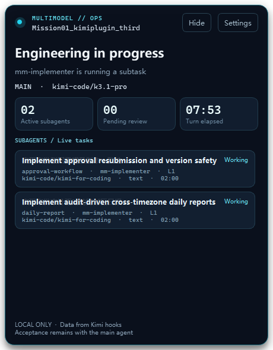
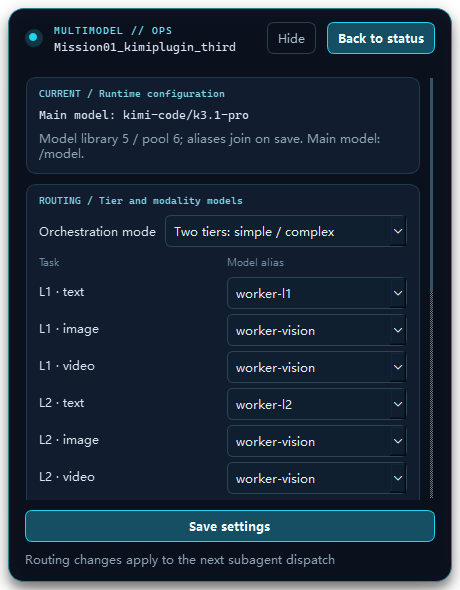

# Kimi Multimodel Orchestrator

**[English](README.md) | [中文](README.zh-CN.md)**

Keep Kimi Code's native main agent in charge of planning and acceptance while delegating only worthwhile, well-bounded subtasks to independently routed models.

> **Experimental Pre-release · v0.5.5**
>
> Windows installation, routing, managed subagents, and the desktop widget have been exercised. The Linux/macOS widget remains unverified and has no compatibility support guarantee yet. Core routing does not depend on PySide6, but that does not mean core routing has been validated on those platforms.

## Screenshots





## Core Features

- **Native-first delegation:** small or tightly coupled work stays with the main agent; native `explore`, `plan`, and `coder` remain preferred for ordinary work.
- **Independent model routing:** separate main and subagent models through `[secondary_model]`, with single-tier, two-tier, modality-only, and auto modes.
- **Capability-aware selection:** filter configured models by `tool_use`, `image_in`, and `video_in`; reuse one alias across multiple tiers when appropriate.
- **Controlled delivery:** fixed-permission `mm-*` profiles, explicit parallel file/test boundaries, structured handoffs, and final main-agent acceptance.
- **Desktop status widget:** real hook-driven model, task, elapsed-time, delivery, and closed-turn states, with tray hide/show and settings access.
- **Safe configuration workflow:** in-widget routing settings, optional public model research, candidate-config validation with `kimi doctor`, backups, and atomic replacement.

## Quick Start

### Prerequisites

- A current Kimi Code release supporting plugins, hooks, and `[secondary_model]`.
- Node.js 18 or later on `PATH`.
- For the bundled Kimi-managed example, complete `/login` first so `managed:kimi-code` and `kimi-code/k3.1-pro` are available.
- Only for the optional widget: Python 3.11+ with `venv` and network access to install the pinned PySide6 package.

### 1. Merge the model-pool configuration

Open [`examples/kimi-managed.config.toml`](examples/kimi-managed.config.toml) and **merge** its entries into `$KIMI_CODE_HOME/config.toml`.

**Do not overwrite your existing configuration.** Preserve existing providers, credentials, model entries, and unrelated settings. The example contains only Kimi-managed defaults and these shared aliases:

| Alias | Default purpose |
| --- | --- |
| `kimi-code/k3.1-pro` | Main-model and high-capability pool fallback |
| `worker-l1` | Simple, low-risk, bounded text work |
| `worker-l2` | Regular through complex implementation, module design, and debugging |
| `worker-vision` | Image/video input for L1/L2 |

The built-in `routing.json` declares exactly the same alias set as the example `[secondary_model.models]` pool. You may adapt model IDs and efforts to your account, but keep alias references consistent.

The example sets `[secondary_model] default_effort = "max"`. This pool-wide setting overrides the bound model's default effort for every spawned subagent without changing the main agent's effort. Aliases that cannot accept `max` must not be silently downgraded; replace them with supported variants before dispatch.

If `KIMI_CODE_HOME` is unset, the default configuration directory is `%USERPROFILE%\.kimi-code` on Windows and `~/.kimi-code` on macOS/Linux.

### 2. Install and reload the plugin

Install a local checkout or a GitHub repository:

```text
/plugins install <local-path-or-github-repository-url>
/reload
```

For remote installation after publication, copy the exact repository URL from its GitHub page and pass that URL to `/plugins install`. No owner placeholder is required.

The plugin is installed per user, not per project. Editing a source checkout does not update the managed copy. Reinstall/update it after source changes, then reload or restart and use a new session so newly updated prompts are actually loaded.

> **Installing or reloading the plugin does not install desktop dependencies or open the widget.** For the visual panel, continue with Step 3, or run `/kimi-multimodel-orchestrator:widget` and follow the guided initialization. The guided flow asks for confirmation before downloading dependencies.

### 3. Initialize the optional widget

For a source checkout, run from its root:

```bash
node scripts/install-widget.mjs
```

For a **GitHub remote installation**, run the installer in the managed plugin directory.

Bash on macOS/Linux or Git Bash on Windows:

```bash
node "${KIMI_CODE_HOME:-$HOME/.kimi-code}/plugins/managed/kimi-multimodel-orchestrator/scripts/install-widget.mjs"
```

Native Windows PowerShell with the default configuration directory:

```powershell
node "$env:USERPROFILE\.kimi-code\plugins\managed\kimi-multimodel-orchestrator\scripts\install-widget.mjs"
```

If you set a custom `KIMI_CODE_HOME` in PowerShell, replace `$env:USERPROFILE\.kimi-code` with `$env:KIMI_CODE_HOME`. The actual managed script path is:

```text
$KIMI_CODE_HOME/plugins/managed/kimi-multimodel-orchestrator/scripts/install-widget.mjs
```

The installer creates an isolated environment at `$KIMI_CODE_HOME/multimodel-orchestrator/widget-venv`; it does not install PySide6 globally. It checks that Python is 3.10–3.15 and, if the configured/default package index fails, retries once with the official `https://pypi.org/simple` index. The pinned PySide6 version remains unchanged.

Skip this step if you only need routing. A new session starts the widget automatically unless auto-start is disabled; you can also wake it manually.

## Commands and Interaction Entry Points

| Entry | Action |
| --- | --- |
| `/kimi-multimodel-orchestrator:orchestrate <task>` | Explicitly enter strict orchestration: main-agent planning, routed `mm-*` delegation, handoff checks, and acceptance |
| `/kimi-multimodel-orchestrator:widget` | Show or wake the widget |
| `/kimi-multimodel-orchestrator:widget settings` | Open widget and routing settings |
| `/kimi-multimodel-orchestrator:evaluate-models` | Explicitly research public model information; may consume main-model tokens and search quota |
| Tray `M` single-click | Show/hide the widget |
| Tray `M` right-click | Open settings or quit the widget |

## Usage and Routing

For ordinary requests, the main agent decides whether delegation has practical value. It should not spawn agents merely to make the plugin appear active.

Use strict orchestration only when you want the complete managed workflow:

```text
/kimi-multimodel-orchestrator:orchestrate Implement the account settings module and verify it
```

A manual pool alias can be requested when it is present in both the active routing file and `[secondary_model.models]`:

```text
Use the native coder with worker-l2 for this bounded implementation, then let the main agent verify it.
```

| Mode | Behavior |
| --- | --- |
| `two-tier` (default) | L1 for simple/low-risk work; L2 for regular through complex work |
| `single` | One execution tier, while text/image/video routes remain separate |
| `modality` | No difficulty tier; route by input modality using `any` |
| `auto` | L1/L2 classification plus local candidate rules and optional public evidence |

To customize routes, copy the built-in `routing.json` to `$KIMI_CODE_HOME/multimodel-orchestrator.routing.json`. This user file replaces the built-in routing as a whole and takes effect on the next dispatch. Do not edit the managed plugin copy.

Legacy L3 routes are migrated in memory to L2, with `worker-l3` mapped to `worker-l2` and `worker-vision-deep` to `worker-vision`. New dispatches do not expose L3 and migration never rewrites user files.

Modality declarations constrain routing; they do not add capabilities. Both the settings UI and auto router honor actual-test `verified` results: `false` vetoes a capability and `true` supplements it. Public research scores are not modality verification, and there is no automatic image/video probe. Image/video routing concerns input understanding and does not by itself provide image, video, speech, or music generation tools.

Auto mode's fit score is a local heuristic, not a unified benchmark. Missing evidence produces an explicit fallback rather than invented scores. `/evaluate-models` researches public model IDs, documentation, model cards, prices, and benchmarks without sending project code or task prompts.

### Headless / CLI Configuration

Core routing does not require PySide6 or a running widget. To manage it entirely from the command line:

1. Copy `$KIMI_CODE_HOME/plugins/managed/kimi-multimodel-orchestrator/routing.json` to `$KIMI_CODE_HOME/multimodel-orchestrator.routing.json`, then edit `mode`, `models`, and `routes` in any text editor. This user file replaces the built-in routing on the next dispatch.
2. Keep every referenced alias present in `[models]` and `[secondary_model.models]` in `config.toml`.
3. Run `kimi doctor config` to validate the model configuration. The dispatch hook separately validates the routing JSON and its tier/modality references when a managed subagent is dispatched.

To prevent background widget startup without using the settings UI, set `"auto_start": false` in `$KIMI_CODE_HOME/multimodel-orchestrator/settings.json` while preserving its other fields. A missing widget runtime never triggers an automatic dependency download.

## Widget and Settings

The widget shows the current project, main model, main-agent phase, turn elapsed time, active/delivered task counts, and each subtask's tier, model, modality, and duration.

A delivered subagent first appears as **pending review**. When the main agent ends the turn with no active subagents, cards and counters become **turn closed**. A stop event alone is never presented as proof of acceptance; failure and interruption remain distinct states.

The settings page provides an **Interface language** selector for 中文 and English. Changes apply immediately to the widget and tray and are saved locally without rewriting model configuration. The page also manages routing modes, model aliases, auto-start, always-on-top, and opacity. Adding a selected alias to the pool writes a candidate configuration, runs the official `kimi doctor`, creates a timestamped backup, and atomically replaces the configuration only after validation succeeds.

Windows uses `pythonw.exe`, so no console window needs to remain open. The local service listens only on `127.0.0.1` with a random access token. Widget state does not intentionally store full prompts, source code, tool output, subagent responses, or API keys.

## Third-Party Low-Cost Model Examples

ERNIE and DeepSeek were used during evaluation, but **they are not built-in defaults and no third-party provider is bundled in `routing.json` or the Kimi-managed example**.

| Example alias | Possible service | Intended scope |
| --- | --- | --- |
| `worker-ernie-flash` | An ERNIE Flash model configured by the user | Low-risk, bounded text work |
| `worker-deepseek-flash` | A DeepSeek Flash model configured by the user | Low-risk, bounded text work with tool calling |

These aliases are examples, not reserved names. To integrate either service:

1. Configure its provider and `[models]` entry using the provider's current Kimi Code-compatible settings and your own credential environment variable.
2. Add the alias to `[secondary_model.models]` and the user routing file's `models` section.
3. Point only suitable tiers/modalities at it. Ensure `tool_use` is configured and do not assign image/video routes unless the model actually supports them.
4. Validate the configuration and run a small, bounded task before using it for parallel implementation.

Keep provider credentials in your local configuration/environment, never in the repository. Model pricing, context, capability, and thinking support remain provider-specific.

## Evaluation and Current Evidence

### Evidence Limits

There is currently **one constrained engineering project and one preliminary comparison set**. `Mission01_plugin`, `Mission01_realplugin`, and `Mission01_kimiplugin` are execution variants of the same Mission01 task—not three independent projects or three repeated trials. Multiple independent projects and repeated comparisons are planned; no statistical significance or general performance claim is made.

### Mission01 Preliminary Comparison

The task combined shared contracts, a database, import logic, approval workflows, cross-timezone reports, and a frontend panel. K3.1 Pro was the main model throughout. Token totals below come from session `usage.record` data and include cache reads, uncached input, and output; all three recorded zero `inputCacheCreation`.

| Version | Wall time | Main-agent tokens | Subagent tokens | Total tokens | Streaming output speed (tok/s) | Public API-equivalent cost | Final checks |
| --- | ---: | ---: | ---: | ---: | --- | ---: | --- |
| `Mission01_plugin` | ~22.43 min | 2,175,362 | — | 2,175,362 | K3.1 Pro: 48.61 | **¥7.28** | 66/66; build passed |
| `Mission01_realplugin` | ~10.09 min | 1,051,944 | 2,360,047 | 3,411,991 | K3.1 Pro: 70.72<br>DeepSeek: 202.32 | **¥3.93** off-peak<br>**¥4.46** at peak | 56/56; build passed |
| `Mission01_kimiplugin` | ~23.22 min | 3,261,115 | 4,598,493 | 7,859,608 | K3.1 Pro: 65.76<br>K2.8: 51.85 | Not calculated: no verifiable public K2.8 token price | 59/59; build passed |

Streaming speed is total output tokens divided by recorded `llmStreamDurationMs`; it is not end-to-end latency or a controlled model benchmark. Test counts and final implementations differ, so test count is not a quality score.

In this single sample, the DeepSeek variant reduced main-agent tokens by about **51.6%** and shortened wall time, while total tokens increased by about **56.8%**. The K2.8 variant did not reproduce the main-token or wall-time reduction.

Costs use public [Kimi API pricing](https://platform.moonshot.cn/docs/pricing/chat) and [DeepSeek China pricing](https://api-docs.deepseek.com/zh-cn/quick_start/pricing) observed during evaluation. They are API-equivalent estimates, **not Kimi Code membership or Extra Usage billing records**. Main agents and DeepSeek used `high` Thinking; K2.8 subagents used `max`, so this was not an equal-effort comparison. Prices and provider behavior may change.

### Parallel-Safety Regression

| Run | Observed result | Meaning |
| --- | --- | --- |
| Initial `Mission01_kimiplugin` | A K2.8 report subagent deleted other backend modules to isolate tests; the main agent restored them before final acceptance | Exposed a real cross-module deletion risk and motivated explicit file/test red lines |
| `Mission01_kimiplugin_third` | Both K2.8 subagents actually loaded the red lines, modified only assigned files, and ran only their specified Vitest file; no deletion, reset, or out-of-scope write; final 76/76 and build passed | Supports the prompt guardrail in this one regression, not a hard-isolation guarantee |

An earlier free-form voxel task also showed scope divergence, extra optimization, and excessive cache reads. **Use delegation cautiously for divergent creative tasks.** That exploratory work is not included in the controlled cost/performance comparison.

### Next Comparison Work

- Add multiple independent projects and engineering types rather than counting copies of one task as new samples.
- Repeat runs with equivalent functional scope, acceptance criteria, and thinking efforts.
- Record main/subagent time, cached/uncached tokens, actual billing basis, rework, and defects separately.
- Evaluate correctness, parallel safety, and cost/time independently; use acceptance tests not authored by the implementers where practical.

Until then, the supported conclusion is narrow: **the plugin is functional, and one sample showed a cost/time benefit signal. Delegation is not guaranteed to save money, improve quality, or reduce elapsed time.**

## Architecture and Security Boundaries

### Execution Model

The main agent retains project direction, shared contracts, integration, and final acceptance. A subagent's `completed` status means only that its own work ended. An independent verifier can collect evidence but cannot replace main-agent acceptance.

Ordinary native agents do not require plugin metadata. Strict `mm-*` dispatch uses the following block:

```text
<!-- KIMI_MULTIMODEL_TASK
{
  "task_id": "T1",
  "summary": "Implement the account settings API",
  "tier": "L2",
  "modality": "text",
  "profile": "mm-implementer",
  "permission": "write",
  "selection": "auto",
  "model": "worker-l2"
}
-->
```

**The orchestration Skill guides the main agent to generate this metadata automatically. Users do not need to type it.** The pre-dispatch hook checks the tier, modality, profile, permission, model alias, and routing consistency. Resumed subagents retain their original model and are not re-routed.

### Executable Contract and Join Gate

For managed parallel implementation, the main agent first creates `orchestration.contract.json`. It points to canonical type/schema files, assigns each module's owner and tests, maps required exports to contract types, declares HTTP bindings, and records security ordering, forbidden response fields, and report scopes. See [`examples/orchestration.contract.json`](examples/orchestration.contract.json).

Subagent briefs reference the contract path/version rather than duplicating full interfaces and DDL. Shared RBAC, data scopes, concurrency invariants, and cross-module interfaces should have one owner; `single`, `modality`, or cost mode must not automatically downgrade security-critical work.

After **all** parallel subagents deliver, the main agent runs the join gate instead of reviewing long source dumps first:

```bash
node "${KIMI_CODE_HOME:-$HOME/.kimi-code}/plugins/managed/kimi-multimodel-orchestrator/scripts/verify-contract.mjs" --root "$PWD" --contract orchestration.contract.json
```

The script uses only Node.js built-ins to check contract structure, files, export declarations, type references, test paths, and HTTP route bindings. It cannot identify the actual writer or prove business correctness. The main agent must still run the project's existing type/build checks and real HTTP/RBAC/database probes. Service-level calls cannot substitute for routes marked `httpTest=required`.

A failed gate resumes only the responsible owner and is rerun after repair. This flow does not change the core routing hook or its fail-open behavior.

### Managed Agent Tool Matrix

| Agent | Fixed tools | Boundary |
| --- | --- | --- |
| `mm-scout` | File/media reads, search, web | No writes or shell |
| `mm-designer` | File/media reads, search, web | Read-only module/interface design; no shell |
| `mm-implementer` | File/media reads/writes, search, shell, web | Assigned implementation only; cannot spawn agents or contact the user |
| `mm-verifier` | File/media reads, search, shell | No Write/Edit; evidence collection is not final acceptance |

### Security Boundaries

- **Prompt red lines are not hard isolation.** Parallel prompts must identify disjoint write paths and exact unit-test files. Subagents must not delete, reset, restore, clean, move, or overwrite other paths, or run unscoped/directory/full-suite tests.
- **Hooks are fail-open.** Missing Node.js, hook failures, and timeouts may allow a call. Routing hooks validate orchestration, not sandboxing.
- **There is no reliable per-child identity in current pre-dispatch tool hooks.** The plugin does not pretend to enforce a child instance's later tool calls dynamically.
- **Shell is not a sandbox.** Even `mm-verifier`, without Write/Edit, can cause side effects through commands. Subagents inherit the host permission mode and allow rules.
- **There is no dynamic per-call tool grant API.** Selecting an Agent profile selects its fixed tool allowlist; a prompt alone is not a security boundary.
- **MCP is disabled by default for managed agents.** The main agent should prepare necessary external results instead of granting broad `mcp__*` access.
- **Non-managed native agents and resumed agents are not subject to managed route restrictions.**

## Development and Contributing

Contributions through GitHub issues and pull requests are welcome. Include a focused scope, reproduction steps, actual/expected behavior, platform, plugin version, and sanitized diagnostic evidence. Keep functional fixes separate from unrelated refactors where practical.

For local development, install the source checkout through the plugin manager rather than fabricating managed installation records. Run the existing syntax and state checks before submitting.

Bash:

```bash
for file in hooks/*.mjs scripts/*.mjs; do node --check "$file" || exit 1; done
python -m compileall -q widget scripts
```

Windows PowerShell:

```powershell
foreach ($file in Get-ChildItem -Path hooks/*.mjs,scripts/*.mjs) { node --check $file.FullName; if ($LASTEXITCODE -ne 0) { exit $LASTEXITCODE } }
python -m compileall -q widget scripts
```

Update both `README.md` and `README.zh-CN.md` when user-facing behavior changes. Store reviewed screenshots under `assets/` and keep both documents' image links synchronized with the available localized assets.

Never commit credentials, OAuth data, real local `config.toml`, `runtime.json`, `wire.jsonl`, configuration backups, private conversation exports, or unredacted session directories. Do not post secrets or private session content in public issues; redact evidence and use a private security-reporting channel when one is configured.

## License

[MIT License](LICENSE). Copyright (c) 2026 镜君 MirroRC. The plugin is provided as-is, without a warranty of performance, cost savings, or platform compatibility beyond the stated validation scope.
