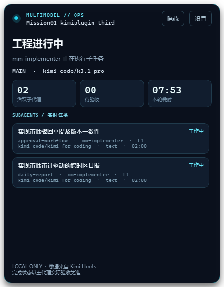
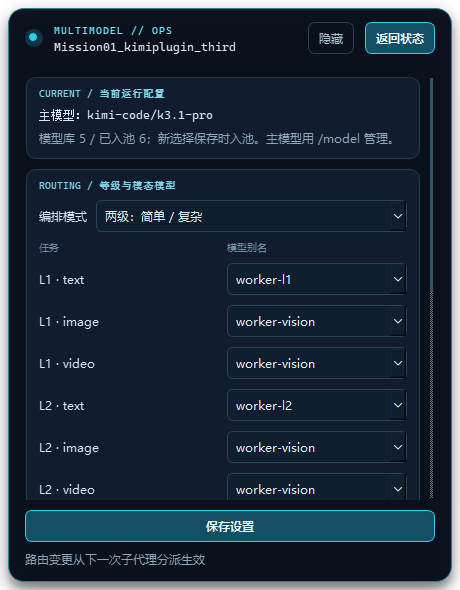

# Kimi 多模型分级编排器

**[English](README.md) | [中文](README.zh-CN.md)**

保留 Kimi Code 原生主代理的策划与验收权，只把有实际收益、边界清晰的子任务委派给独立路由的模型。

> **Experimental Pre-release（实验性预发布）· v0.5.1**
>
> Windows 下的插件安装、模型路由、受管子代理和桌面悬浮窗已经过实际验证。Linux/macOS 悬浮窗仍未验证，暂不提供兼容支持保证。核心路由不依赖 PySide6，但这也不代表核心路由已在这些平台通过验证。

## 界面截图





## 核心特性

- **原生优先委派**：小任务和紧密耦合工作由主代理直接完成，普通工作仍优先使用原生 `explore`、`plan`、`coder`。
- **独立模型路由**：通过 `[secondary_model]` 分离主/子代理模型，支持单级、两级、仅模态和自动分配模式。
- **按能力选择**：依据 `tool_use`、`image_in`、`video_in` 过滤已配置模型，同一别名可以复用于多个等级。
- **受控交付**：固定权限 `mm-*` Agent、明确的并行文件/测试边界、结构化 Handoff，以及主代理最终验收。
- **桌面状态悬浮窗**：通过真实 Hooks 展示模型、任务、耗时、交付和本轮结束状态，支持托盘隐藏/唤醒及设置入口。
- **安全的配置流程**：同窗口路由设置、可选公开模型资料研究、候选配置 `kimi doctor` 校验、备份和原子替换。

## 快速上手

### 先决条件

- 支持插件、Hooks 和 `[secondary_model]` 的当前 Kimi Code 版本。
- Node.js 18 或更高版本，且 `node` 位于 `PATH`。
- 使用内置 Kimi 托管示例时，先完成 `/login`，确保 `managed:kimi-code` 和 `kimi-code/k3.1-pro` 可用。
- 仅使用可选悬浮窗时需要：Python 3.11+、可用的 `venv`，以及安装固定版本 PySide6 所需的网络。

### 第 1 步：合并模型池配置

打开 [`examples/kimi-managed.config.toml`](examples/kimi-managed.config.toml)，将其中条目**合并**到 `$KIMI_CODE_HOME/config.toml`。

**不要覆盖现有配置。** 必须保留已有 providers、凭据、模型条目和其他无关设置。示例只包含 Kimi 托管默认模型，并使用以下一组共享别名：

| 别名 | 默认用途 |
| --- | --- |
| `kimi-code/k3.1-pro` | 主模型及高能力模型池回退 |
| `worker-l1` | 简单、低风险、边界清晰的文本工作 |
| `worker-l2` | 常规实现、模块设计和调试 |
| `worker-l3` | 使用 `max` 档位的复杂推理和困难工作 |
| `worker-vision` | 使用 `high` 档位的 L1/L2 图像/视频输入理解 |
| `worker-vision-deep` | 使用 `max` 档位的 L3 图像/视频输入理解 |

内置 `routing.json` 声明的别名集合与示例 `[secondary_model.models]` 完全一致。可以按账户情况调整实际模型 ID 和推理档位，但必须保持别名引用一致。

未设置 `KIMI_CODE_HOME` 时，默认配置目录在 Windows 上为 `%USERPROFILE%\.kimi-code`，在 macOS/Linux 上为 `~/.kimi-code`。

### 第 2 步：安装并重载插件

可以安装本地目录或 GitHub 仓库：

```text
/plugins install <本地目录或-GitHub-仓库地址>
/reload
```

正式发布后进行远程安装时，复制 GitHub 仓库页面上的实际地址并传给 `/plugins install`，无需所有者占位符。

插件按用户安装，而不是按项目安装。修改源码目录不会更新受管副本；源码变更后需要重新安装/更新，再重载或重启并使用新会话，确保新提示词真正被加载。

### 第 3 步：初始化可选悬浮窗

使用源码目录时，在其根目录运行：

```bash
node scripts/install-widget.mjs
```

通过 **GitHub URL 远程安装**后，应运行受管插件目录中的安装器。

macOS/Linux 的 Bash 或 Windows 的 Git Bash：

```bash
node "${KIMI_CODE_HOME:-$HOME/.kimi-code}/plugins/managed/kimi-multimodel-orchestrator/scripts/install-widget.mjs"
```

使用默认配置目录的 Windows 原生 PowerShell：

```powershell
node "$env:USERPROFILE\.kimi-code\plugins\managed\kimi-multimodel-orchestrator\scripts\install-widget.mjs"
```

如果在 PowerShell 中自定义了 `KIMI_CODE_HOME`，将 `$env:USERPROFILE\.kimi-code` 替换为 `$env:KIMI_CODE_HOME`。实际脚本路径为：

```text
$KIMI_CODE_HOME/plugins/managed/kimi-multimodel-orchestrator/scripts/install-widget.mjs
```

安装器会在 `$KIMI_CODE_HOME/multimodel-orchestrator/widget-venv` 创建隔离环境，不会全局安装 PySide6。

只需要模型路由时可以跳过本步。未关闭自动启动时，新会话会自动启动悬浮窗，也可以手动唤醒。

## 斜杠命令与交互入口速查

| 入口 | 作用 |
| --- | --- |
| `/kimi-multimodel-orchestrator:orchestrate <任务>` | 显式进入严格编排：主代理规划、路由 `mm-*` 子代理、交付检查和验收 |
| `/kimi-multimodel-orchestrator:widget` | 显示或唤醒悬浮窗 |
| `/kimi-multimodel-orchestrator:widget settings` | 打开悬浮窗与路由设置页 |
| `/kimi-multimodel-orchestrator:evaluate-models` | 显式联网研究公开模型资料；可能消耗主模型 token 和搜索配额 |
| 单击系统托盘 `M` 图标 | 显示/隐藏悬浮窗 |
| 右键系统托盘 `M` 图标 | 打开设置或退出悬浮窗 |

## 使用与路由

普通请求由主代理判断委派是否具有实际收益，不应为了让插件显得已启用而强行启动子代理。

需要完整受管流程时，显式使用严格编排：

```text
/kimi-multimodel-orchestrator:orchestrate 实现账户设置模块并完成验证
```

当别名同时存在于当前路由文件和 `[secondary_model.models]` 时，可以手动指定：

```text
使用原生 coder 和 worker-l2 完成这个边界清晰的实现，再由主代理验收。
```

| 模式 | 行为 |
| --- | --- |
| `two-tier`（默认） | L1 处理简单/低风险工作；L2 覆盖常规至复杂工作 |
| `single` | 只使用一个执行等级，但仍分别路由文本/图像/视频 |
| `modality` | 不区分难度，以 `any` 标记并按输入模态路由 |
| `auto` | 使用 L1/L2/L3 分类、本地候选规则和可选公开资料 |

需要自定义路由时，将内置 `routing.json` 复制为 `$KIMI_CODE_HOME/multimodel-orchestrator.routing.json`。该用户文件会完整替代内置路由，并从下一次分派生效。不要修改受管插件副本。

模态声明只约束路由，不会赋予模型能力。当前过滤依据为配置中的 capabilities 和可选实测结果，不是自动真实模态探测。图像/视频路由针对输入理解，本身不提供生图、生视频、语音或音乐生成工具。

auto 模式的适配分是本地启发式参考值，不是统一 benchmark。资料不足时明确回退，不虚构评分。`/evaluate-models` 只研究公开模型 ID、官方文档、模型卡、价格和公开评测，不发送项目代码或任务正文。

## 悬浮窗与设置页

悬浮窗展示当前项目、主模型、主代理阶段、本轮耗时、活跃/待验收任务数，以及每个子任务的等级、模型、模态和耗时。

子代理刚交付时显示**待验收**。主代理结束本轮且没有活跃子代理后，卡片和计数转为**本轮结束**。仅凭 Stop 事件不会宣称验收通过；失败和中断仍是独立状态。

设置页提供**界面语言**选择器，可选择中文或 English。切换后立即更新悬浮窗和系统托盘，并只保存本地语言偏好，不改写模型配置。设置页同时管理路由模式、模型别名、自动启动、置顶和不透明度。将选中的新别名加入模型池时，会写入候选配置、运行官方 `kimi doctor`、创建时间戳备份，并且只在校验成功后原子替换正式配置。

Windows 使用 `pythonw.exe`，无需保持控制台窗口。悬浮窗服务只监听 `127.0.0.1` 并使用随机访问令牌。界面状态不会主动保存完整提示词、源码、工具输出、子代理响应或 API Key。

## 第三方低成本模型接入示例

ERNIE 和 DeepSeek 曾用于测评，但**它们不是内置默认能力；`routing.json` 和 Kimi 托管示例均未内置任何第三方供应商**。

| 示例别名 | 可选服务 | 建议范围 |
| --- | --- | --- |
| `worker-ernie-flash` | 用户自行配置的 ERNIE Flash 模型 | 低风险、边界清晰的文本工作 |
| `worker-deepseek-flash` | 用户自行配置的 DeepSeek Flash 模型 | 低风险、边界清晰且需要工具调用的文本工作 |

这些别名只是示例，不是保留名称。接入任一服务时：

1. 按供应商当前的 Kimi Code 兼容配置方式设置 provider 和 `[models]` 条目，凭据使用自己的环境变量。
2. 将别名加入 `[secondary_model.models]` 以及用户路由文件的 `models`。
3. 只把合适的等级/模态指向它。确保配置 `tool_use`；未实际支持图像/视频时不得分配对应路由。
4. 先校验配置，再用小型、边界清晰的任务验证，之后才用于并行实现。

供应商凭据只保留在本机配置/环境变量中，不要提交到仓库。模型价格、上下文、能力和 Thinking 支持均以各供应商实际情况为准。

## 测评与当前证据

### 证据边界

目前只有**一个受约束工程项目、一组初步对照**。`Mission01_plugin`、`Mission01_realplugin` 和 `Mission01_kimiplugin` 是同一 Mission01 任务的不同执行版本，不是三个独立项目，也不是三次重复实验。后续将补足多个独立项目和重复对比测试，当前不作统计显著性或普遍性能优势声明。

### Mission01 初步对照

任务包含共享契约、数据库、导入、审批工作流、跨时区报表和前端面板，主代理均使用 K3.1 Pro。token 总量来自会话 `usage.record`，包含缓内读取、缓外输入和输出；三组 `inputCacheCreation` 均为 0。

| 执行版本 | 总耗时 | 主代理 token | 子代理 token | 总 token | 流式输出速度（tok/s） | 公开 API 等值成本 | 最终检查 |
| --- | ---: | ---: | ---: | ---: | --- | ---: | --- |
| `Mission01_plugin` | 约 22.43 分钟 | 2,175,362 | — | 2,175,362 | K3.1 Pro：48.61 | **¥7.28** | 66/66，构建通过 |
| `Mission01_realplugin` | 约 10.09 分钟 | 1,051,944 | 2,360,047 | 3,411,991 | K3.1 Pro：70.72<br>DeepSeek：202.32 | 闲时 **¥3.93**<br>峰价 **¥4.46** | 56/56，构建通过 |
| `Mission01_kimiplugin` | 约 23.22 分钟 | 3,261,115 | 4,598,493 | 7,859,608 | K3.1 Pro：65.76<br>K2.8：51.85 | 未计算：缺少可核验的 K2.8 公开 token 单价 | 59/59，构建通过 |

流式速度为输出 token 除以会话记录的 `llmStreamDurationMs`，不是端到端时延，也不是受控模型跑分。各版本测试数量和最终实现范围不同，不能把测试数直接当作质量分数。

在这一个样本中，DeepSeek 版本的主代理 token 比纯主代理版本减少约 **51.6%**，墙钟时间缩短，但总 token 增加约 **56.8%**。K2.8 版本没有复现主代理 token 或耗时下降。

成本使用测评时查询的 [Kimi API 公开价格](https://platform.moonshot.cn/docs/pricing/chat)和 [DeepSeek 中国开放平台价格](https://api-docs.deepseek.com/zh-cn/quick_start/pricing)换算，**不是 Kimi Code 会员或 Extra Usage 的实际扣费记录**。主代理与 DeepSeek 使用 `high` Thinking，K2.8 子代理使用 `max`，因此不是严格同档位比较。价格和供应商行为可能变化。

### 并行安全回归

| 版本 | 观察结果 | 说明 |
| --- | --- | --- |
| 初测 `Mission01_kimiplugin` | K2.8 报表子代理曾删除其他后端模块用于隔离测试，主代理在最终验收前恢复 | 暴露真实跨模块删除风险，促成明确的文件/测试红线 |
| 复测 `Mission01_kimiplugin_third` | 两个 K2.8 子代理均实际加载红线，只修改分配文件并运行各自指定的 Vitest 文件；无删除、重置或越权写入；最终 76/76、构建通过 | 支持提示红线在这一个回归样本中有效，但不构成硬隔离保证 |

早期自由体素任务还出现过范围发散、额外优化和大量缓存读取。**发散型创作任务应慎用委派。** 该探索性试验不纳入受控成本/性能对照。

### 后续对照计划

- 增加多个独立项目和不同工程类型，不再把同一任务的副本当作新增样本。
- 在相同功能范围、验收标准和推理档位下重复运行。
- 分别记录主/子代理耗时、缓内/缓外 token、实际计费口径、返工和缺陷。
- 将功能正确性、并行安全和成本/耗时分开评估；有条件时使用未由实现者编写的验收测试。

在补足这些数据前，结论仅限于：**插件功能可用，并在一个样本中出现降本缩时信号；不保证委派必然省钱、提质或缩短时间。**

## 架构原理与安全边界

### 执行结构

主代理始终保留工程方向、共享契约、集成和最终验收。子代理的 `completed` 只表示其自身作业结束。独立验证子代理可以收集证据，但不能替代主代理验收。

普通原生 Agent 不需要插件元数据。严格 `mm-*` 分派使用以下结构：

```text
<!-- KIMI_MULTIMODEL_TASK
{
  "task_id": "T1",
  "summary": "实现账户设置接口",
  "tier": "L2",
  "modality": "text",
  "profile": "mm-implementer",
  "permission": "write",
  "selection": "auto",
  "model": "worker-l2"
}
-->
```

**元数据由编排 Skill 引导主代理自动生成，用户无需手动输入。** 分派前 Hook 检查等级、模态、Agent 类型、权限、模型别名和路由一致性。续跑子代理保留原模型，不重新路由。

### 受管 Agent 工具矩阵

| Agent | 固定工具范围 | 边界 |
| --- | --- | --- |
| `mm-scout` | 文件/媒体读取、检索、Web | 无写入、无 Shell |
| `mm-designer` | 文件/媒体读取、检索、Web | 只读模块/接口设计，无 Shell |
| `mm-implementer` | 文件/媒体读写、检索、Shell、Web | 仅实现分配范围，不能派生代理或联系用户 |
| `mm-verifier` | 文件/媒体读取、检索、Shell | 无 Write/Edit；验证证据不等于最终验收 |

### 安全边界

- **提示红线不是硬隔离。** 并行提示必须明确互不重叠的写入路径和指定单测文件。子代理不得删除、重置、恢复、清理、移动或覆盖其他路径，也不得运行无范围、目录级或全库测试。
- **Hooks 是 fail-open。** Node.js 缺失、Hook 崩溃或超时时，宿主仍可能允许调用。路由 Hook 是编排校验，不是沙箱。
- **当前分派前工具 Hook 没有可靠的子代理身份关联。** 插件不会伪称能够动态拦截某个子代理实例的后续工具调用。
- **Shell 不是沙箱。** 即使 `mm-verifier` 没有 Write/Edit，命令仍可能产生副作用。子代理继承宿主权限模式和允许规则。
- **没有动态逐调用工具授权接口。** 选择 Agent 类型即选择固定工具白名单，提示词本身不是安全边界。
- **受管 Agent 默认不开放 MCP。** 主代理应准备必要的外部工具结果，而不是授予宽泛的 `mcp__*` 访问。
- **非受管原生 Agent 和续跑 Agent 不受受管路由限制。**

## 开发与贡献

欢迎通过 GitHub Issues 和 Pull Requests 贡献。请提供聚焦的范围、复现步骤、实际/预期行为、平台、插件版本和脱敏诊断证据。功能修复应尽量与无关重构分开。

本地开发时，通过插件管理器安装源码目录，不要手工伪造受管安装记录。提交前运行现有语法和状态检查。

Bash：

```bash
for file in hooks/*.mjs scripts/*.mjs; do node --check "$file" || exit 1; done
python -m compileall -q widget scripts
```

Windows PowerShell：

```powershell
foreach ($file in Get-ChildItem -Path hooks/*.mjs,scripts/*.mjs) { node --check $file.FullName; if ($LASTEXITCODE -ne 0) { exit $LASTEXITCODE } }
python -m compileall -q widget scripts
```

用户可见行为变化时，同时更新 `README.md` 和 `README.zh-CN.md`。审核后的截图放入 `assets/`，并确保双语文档的图片链接与现有本地化资源一致。

不得提交凭据、OAuth 数据、真实本机 `config.toml`、`runtime.json`、`wire.jsonl`、配置备份、私有对话导出或未脱敏会话目录。公开 Issue 中不要发布密钥或私有会话内容；证据应先脱敏，配置私密安全报告渠道后再使用该渠道报告漏洞。

## 开源许可

[MIT License](LICENSE)。Copyright (c) 2026 镜君 MirroRC。插件按现状提供，不保证超出上述验证范围的性能、成本收益或平台兼容性。
